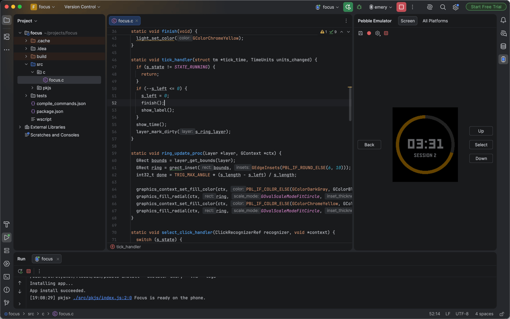

# Develop for Pebble

[](https://plugins.jetbrains.com/plugin/35353-develop-for-pebble)
[](https://plugins.jetbrains.com/plugin/35353-develop-for-pebble)
[](https://plugins.jetbrains.com/plugin/35353-develop-for-pebble/reviews)
[](https://github.com/dtretyakov/idea-pebble/actions/workflows/build.yml)

Build, run and deploy apps and watchfaces for Pebble smartwatches — in C or in Alloy (JavaScript and
TypeScript) — in IntelliJ IDEA, CLion and WebStorm.

The plugin drives the official [Pebble SDK](https://developer.repebble.com/sdk/) and pebble-tool
rather than replacing them: the build is `pebble build`, the emulator is the SDK's, and code
insight comes from the IDE's own engines fed with the SDK's headers and typings.



## Getting started

1. **Install [Develop for Pebble](https://plugins.jetbrains.com/plugin/35353-develop-for-pebble)**
   from *Settings | Plugins | Marketplace*.
2. Open a folder whose `package.json` has a `pebble` section — or use **New Project | Pebble** once
   the SDK is set up.
3. Click **Set Up Pebble SDK** in the balloon the project opens with. It installs pebble-tool and the
   latest SDK in the background, and uv if you have none; anything that needs `sudo` or Homebrew is
   offered as a command to run in the terminal. **Tools | Pebble | Check Environment** shows the
   whole checklist.
4. Pick a platform beside the Run button and press Run. The emulator appears in the **Pebble
   Emulator** tool window; the app's logs in the Run console.

For C in IntelliJ IDEA or WebStorm, install the [LSP4IJ](https://plugins.jetbrains.com/plugin/23257-lsp4ij)
plugin and clangd; CLion needs neither.

**Installing from disk instead.** Every tagged release carries a signed zip on the
[Releases page](https://github.com/dtretyakov/idea-pebble/releases): *Settings | Plugins | ⚙ |
Install Plugin from Disk*. Signed, so it installs without the dialog that asks whether to trust
it. Pre-release versions are marked as such.

## What it does

| | |
|---|---|
| **Start a project** | New Project \| Pebble, in C or Alloy, and the SDK to build it installed from one button. |
| **Target a platform** | The platform chooser beside Run, which every build, run, debug and code insight follows. |
| **Run** | Builds with `pebble build` and runs in the emulator — its screen, buttons and touch in a tool window — or on a watch, with the app's logs in the console. |
| **Debug** | C and Alloy in the IDE's debugger: breakpoints and conditions, stepping, the stack, variables and expressions. |
| **Write code** | C completion and navigation over the SDK's headers for the chosen platform, Alloy completion from the SDK's typings, and checks for calls a platform only stubs out, missing resources and unused message keys. |
| **Watch memory** | Each platform's memory after a build, and a word when an app exits with memory it never freed. |
| **Capture** | Screenshots of every platform side by side, and GIFs of the emulator's screen. |
| **Test** | UI test scenarios in the IDE's test runner, each platform's screens compared with reference screenshots. |
| **Publish** | A release checked against what the Pebble appstore takes, then published with `pebble publish`. |
| **Work with an agent** | Pebble tools on the IDE's MCP server, and a skill that tells the agent how to use them. |

## Requirements

- IntelliJ IDEA, CLion or WebStorm 2026.1 or newer.
- macOS; Linux with glibc 2.38 or later, which the emulator needs; or Windows through WSL — see
  [Windows](#windows).
- The Pebble SDK, which **Set Up Pebble SDK** installs. It needs Node.js and npm, which the
  checklist offers to install where they are missing.
- For C in IntelliJ IDEA or WebStorm: [LSP4IJ](https://plugins.jetbrains.com/plugin/23257-lsp4ij)
  and clangd.

## Coding agents

The plugin adds Pebble tools to the IDE's own MCP server, so an agent such as Claude Code, Codex,
Junie or Copilot can build the app, run it in the emulator, read its logs, press its buttons,
look at its screen and check the SDK's API.

1. Connect the agent to the IDE: **Settings | Tools | MCP Server**, enable the server, then
   **Auto-Configure** for your agent.
2. Give the agent the `pebble` skill, which tells it how to use those tools. New projects have it
   already. For an existing project, use **Tools | Add Pebble Skill for Agents**, which writes it
   to `.agents/skills` and `.claude/skills`, where Claude Code, Codex, Junie, Cursor and Copilot
   look. For Claude Code in every project, install it from this repository:

   ```
   /plugin install pebble --marketplace dtretyakov/idea-pebble
   ```

[Coding agents](docs/agents.md) has the details, and the commands for Claude Code before 2.1.275.

## Windows

The Pebble SDK does not run on Windows itself, only inside WSL, and the plugin runs it there: the
IDE stays on Windows, while pebble-tool, the build, the emulator, gdb and clangd run in a WSL
distribution. The emulator's screen, logs and debuggers are in the IDE as on a Mac or Linux.

1. No WSL yet: the balloon offers **Install Ubuntu in WSL**, which runs
   `wsl --install -d Ubuntu-24.04` in the IDE's terminal (22.04 is too old for the emulator).
   Windows may restart, and Ubuntu asks for a user name and password once.
2. Then one command in a terminal of that distribution, which the balloon also runs for you: the
   SDK's own list of Ubuntu packages — Node.js and npm, without which `pebble sdk install` fails,
   and the emulator's libraries — after `sudo` asks for the password.
3. Then **Set Up Pebble SDK**, as everywhere else.

Projects can be in the distribution — open them as `\\wsl.localhost\Ubuntu-24.04\home\…`, where
builds are several times faster — or on a Windows drive, which the distribution sees as `/mnt/c/…`.
With several distributions, **Settings | Languages & Frameworks | Pebble | WSL** chooses one; by
default it is the one the project is in, else WSL's default. IDEA and WebStorm run clangd in the
distribution (`sudo apt install clangd`). CLion's own C engine reads the compile database the SDK
writes with Linux paths only through a WSL toolchain, which has not been tried yet. Installing on a watch over `--adb` needs
adb inside WSL, which sees no USB devices without usbipd-win.

## Documentation

- [Architecture](docs/architecture.md) — how the plugin is put together, and why.
- [Notes on the Pebble SDK](docs/pebble-sdk-notes.md) — what a client of pebble-tool needs to know.
- [Coding agents](docs/agents.md) — the MCP tools and the skill, and why they are what they are.
- [Developing](docs/developing.md) — building and testing the plugin.
- [Roadmap](docs/roadmap.md) — what is done, and what is next.
- [Contributing](CONTRIBUTING.md) — bug reports, and the checks a pull request should pass.
- [Security](SECURITY.md) — reporting a vulnerability, and what the plugin touches.
- [Publishing](PUBLISHING.md) — releases, signing, the Marketplace listing.
- [Changelog](CHANGELOG.md)

## License

[Apache 2.0](LICENSE).

## Trademarks

Pebble is a trademark of Core Devices LLC. Develop for Pebble is an independent, open-source
project, not affiliated with or endorsed by Core Devices.
